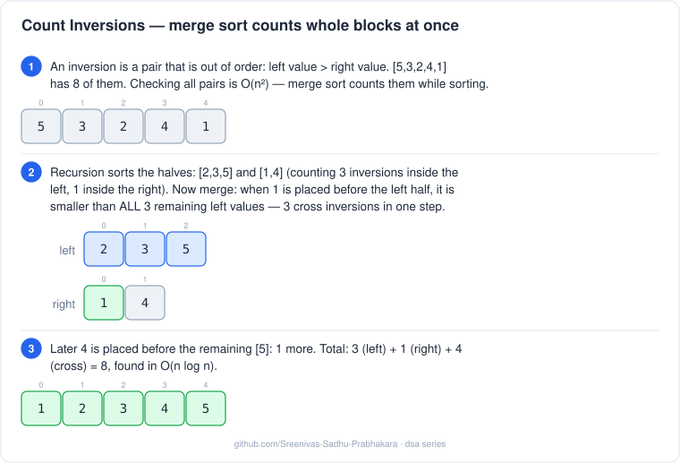

# Count Inversions in an Array

> Striver SDE Sheet 012 · Day 2 Arrays — merge sort, counting a whole block of inversions at each cross-half comparison. Go, stdlib only, tested.

## Problem

Count the pairs (i, j) with i < j but nums[i] > nums[j] — how far the array is from sorted. A fully descending array of n elements has n·(n−1)/2 inversions, so the count needs a 64-bit result and better than the O(n²) pair scan.

## Approach

Piggyback on merge sort. When merging two sorted halves, the moment an element from the right half is placed before the rest of the left half, it is smaller than *all* remaining left elements — that is `mid − i` inversions discovered in O(1). Summing these during every merge counts all inversions exactly once (within-half pairs are counted by the recursive calls). The input is copied first so the caller's slice stays untouched.

**Complexity:** O(n log n) time, O(n) extra space.

## Visual walkthrough

Read the picture top to bottom — each numbered frame is one moment of the algorithm
running on this repo's test example.

## Run

    go test ./...   # verify
    go run .        # demo

---

One of 191 repos solving Striver's SDE Sheet in Go — stdlib only, one problem per repo, every solution tested. Browse the set: [`dsa-*` repos](https://github.com/Sreenivas-Sadhu-Prabhakara?tab=repositories&q=dsa-&type=source).
